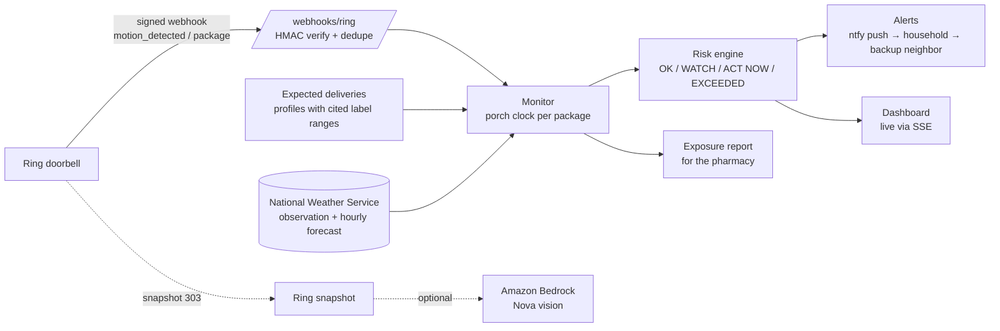

# PorchSafe

**Your Ring doorbell sees the insulin arrive. PorchSafe makes sure it doesn't freeze, or cook, on the porch.**

**Track:** Ring (priority categories: caretaking, IoT home automation). **Mini challenge:** AWS Builder (Amazon Bedrock).

## The problem

Millions of Americans get prescriptions by mail. The trip is hard on them:

- A University of Utah study shipped 48 packages with temperature loggers to six U.S. cities. **Every one** went outside the recommended range during transit: 68–87% of the time in winter and 27–54% in summer. ([Pharmacy Times, Dec 2020](https://pharmacytimes.com/view/study-shows-mail-order-prescriptions-may-be-often-exposed-to-unsafe-temperatures))
- The *New York Times* (Aug 2024) reported insulin that froze in a snowstorm delivery, and a liquid transplant drug shipped in 102°F heat in a plastic envelope; that patient ended up hospitalized. FDA storage rules **don't cover shipments to patients**. ([Advisory Board summary](https://advisory.com/daily-briefing/2024/08/19/mail-order-drugs))
- Damage isn't always visible. A medicine can degrade from heat without changing color.

Nobody can control the delivery truck, but the household can control **how long a package sits on the porch**, and a Ring doorbell already sees the moment it arrives. No one connects those two facts to the temperature outside and the limits on the label. PorchSafe does.

## What it does

1. **You say what's coming.** "Lantus pens from the mail-order pharmacy" (insulin), an EpiPen, an inhaler, a refrigerated biologic, a grocery kit.
2. **Ring sees the drop-off.** The `motion_detected` webhook with a package sub-type, signed by Ring, starts a **porch clock** for that item.
3. **PorchSafe compares the porch with the label.** It reads the live **National Weather Service** observation and hourly forecast for your address and checks them against the item's labeled storage range and permitted excursions.
   - *"Bring the insulin inside now: 24°F on the porch."* (The insulin label says do not freeze.)
   - *"Bring the EpiPen inside within 50 min: 62°F is outside its storage range."* (This is inside the label's 59–86°F excursion window, so a time budget applies.)
   - *"National Weather Service forecast in about 45 min: 33°F is below the labeled minimum…"* The warning comes before the temperature drops.
4. **It escalates.** A phone push goes to the household (via [ntfy](https://ntfy.sh), no account needed). If nobody brings the package in within a set time, a **backup contact such as a neighbor** gets asked.
5. **It writes an exposure report.** This is a printable record to send the pharmacy: when Ring saw the delivery, minutes on the porch, the recorded temperatures, what the label allows, and the Ring snapshot. It replaces "I think it got cold" with a dated record.
6. **It handles surprise parcels.** For a delivery you didn't log, PorchSafe asks "Is this medicine or food?" instead of guessing. With Bedrock turned on, **Amazon Bedrock (Nova, image input)** looks at the Ring snapshot and points out what looks like a pharmacy or keep-cold shipment.

### Built to be trusted

- **Every threshold has a cited source**, and the dashboard shows it next to the alert (`porchsafe/profiles.py`):

  | Item | Labeled range | Source |
  |---|---|---|
  | Insulin | 36–46°F (fridge); 59–86°F once opened; **do not freeze** | [MedlinePlus](https://medlineplus.gov/ency/patientinstructions/000962.htm) |
  | EpiPen | 68–77°F; excursions 59–86°F; do not refrigerate | [Prescribing information §16.2](https://medlibrary.org/lib/rx/meds/epipen-5/page/3/) |
  | Albuterol HFA | 68–77°F; excursions 59–86°F; >120°F may burst | [Ventolin HFA PI §16](https://medlibrary.org/lib/rx/meds/ventolin-hfa-5/page/4/) |
  | Perishable food | ≤40°F; at most 2 h above it (1 h when >90°F) | [USDA rule via UF/IFAS](https://blogs.ifas.ufl.edu/browardco/2023/10/02/food-safety-the-2-hour-rule/) |
- **It never says a medicine is "fine" or "ruined."** It tracks porch conditions against the label and tells the person to ask their pharmacist when the label was exceeded.
- **It is upfront about what it measures.** It uses outdoor air temperature as a stand-in for the package temperature, and every alert says so. If the porch gets direct sun, time budgets are halved.
- **Missing data is never treated as safe.** If the weather feed is down, the status is "bring it in," never "OK."

## How it uses Ring

| Ring capability | Where | Used for |
|---|---|---|
| Webhooks v1.1 (`motion_detected` with package sub-types, `button_press`), **HMAC-SHA256 `X-Signature` checked on the raw body**, de-duplicated by `meta.request_id`, 200 returned inside Ring's 5-second budget | `porchsafe/ring.py`, `POST /webhooks/ring` | Starting and stopping the porch clock |
| `GET /v1/devices?include=status,capabilities` | `RingClient.devices` | Device discovery (`python -m porchsafe.doctor`) |
| `GET /v1/history/devices/{id}/events` | `RingClient.history`, Event History poller | Live mode without webhooks (the Developer Playground doesn't deliver them) |
| `POST /v1/devices/{id}/media/image/download` → **303 to a pre-signed URL, fetched without the bearer token** | `RingClient.snapshot` | The delivery photo for the report, and the input to Bedrock vision |
| OAuth token exchange and refresh-token rotation, required `User-Agent` and `Hardware_Id` headers, 429 `Retry-After` back-off | `RingClient`, `POST /oauth/token` | Production account linking |

**No Ring hardware needed for the demo.** The built-in simulator, and `python -m porchsafe.simulate delivery`, send Ring's documented v1.1 payloads **signed exactly as Ring signs them** to the real `/webhooks/ring` endpoint, so the demo runs through the same verification code a live doorbell would.

## Architecture



## Run it

Requires Python 3.10 or later.

```bash
pip install -r requirements.txt
cp .env.example .env            # set PORCH_LAT/PORCH_LON and your ntfy topic

python -m porchsafe.app          # open http://localhost:8090
python -m porchsafe.doctor       # check live NWS (and Ring, if a token is set)
python -m pytest -q              # 14 tests
```

**Demo in 60 seconds:**

1. In *Expecting a delivery*, choose **Insulin** and name it "Lantus pens".
2. In the Simulator, click **Package dropped off**. Ring's signed webhook arrives, and the porch clock and the label band appear.
3. Type **24** as the outdoor temperature. The insulin turns to **Bring inside now**, and a push goes out.
4. Set the clock to **120×**. After the escalation window, the **neighbor** is asked.
5. Click **I brought it inside**, then **Exposure report**.

To show a full scenario without live weather, use `PORCHSAFE_WEATHER=fixture:winter`, `fixture:heat` or `fixture:mild`. These are illustrative scenarios, labeled as such in the UI.

**With a real Ring account:** put a Developer Playground token in `RING_ACCESS_TOKEN` (valid for about 30 min) and run `python -m porchsafe.doctor` to list your devices. Then set `PORCHSAFE_RING_POLL=1` to pick up package events from Event History. For production webhooks, register `https://<host>/webhooks/ring` as the Webhook URL and `https://<host>/oauth/token` as the Token Exchange URL in the Ring Developer Portal, and set `RING_HMAC_KEY`.

## AWS (AWS Builder mini challenge)

- **Amazon Bedrock Runtime, Converse API with image input** (`porchsafe/vision.py`, turned on with `PORCHSAFE_BEDROCK=1`). Default model `us.amazon.nova-lite-v1:0`. It classifies the Ring snapshot of an unexpected parcel as pharmacy, keep-cold, groceries or ordinary, and returns the visible evidence. The result is only used to ask the household; the model never sets a temperature profile or describes people.
- **Container** (`Dockerfile`), ready for AWS App Runner or ECS. It needs a public HTTPS URL for Ring webhooks.

## Limitations and next steps

- The Ring sub-type names for parcels are matched defensively (`package_delivery`, `package`, `package_pickup`, …), because Ring's docs list motion sub-types only by example.
- Air temperature is a proxy. A small temperature probe in the porch drop box, or a Ring indoor temperature sensor in an enclosed porch, would measure the package directly. Ring sensor support is in early access.
- Pharmacy integrations could register expected deliveries automatically from shipping notices.

## Built during the hackathon

All code here was written during the Amazon Developer Hackathon 2026 submission window.

## License

MIT. See [LICENSE](LICENSE).
# Porch-safe
